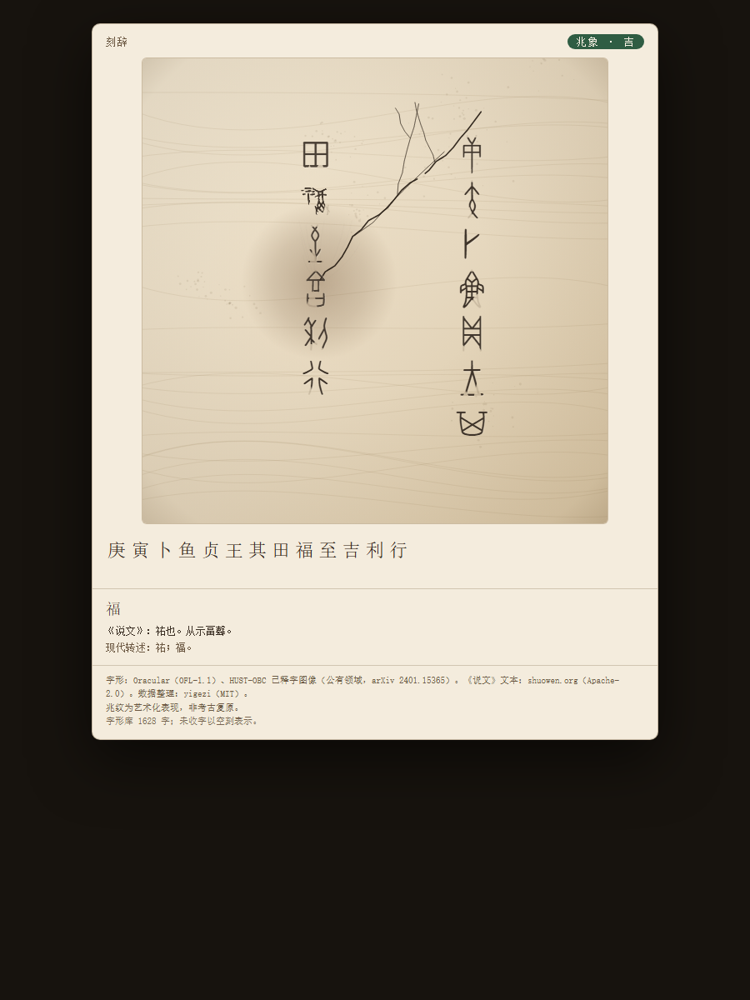

# 甲骨贞人 · DSH skill（移植版）

> **本仓库是移植版，不是原版，也不是官方版本。**
>
> 上游仓库：<https://github.com/SodiumHypo/dsh-plugins/tree/master/packages/zhenren>（当前 `master` 为 `1.1.0-beta.1`，即本仓库的移植基线）。
>
> 本仓库把 **`dsh-plugin-zhenren` 1.1.0-beta.1**（DSH 插件，MIT，版权归「甲骨贞人 contributors」）的占卜协议、数据、字体、HUST-OBC 图像字形与卡片行为，移植成按需加载的 DSH skill。
> 原插件、原数据与字体的版权/授权仍归原作者与上游来源；本仓库不代表原项目，也不对原项目作任何官方声明。
> 移植代码是依据上游插件 `lib/*.js.map` 还原的 TS 源码重写的；数据/字体/图像来源与许可见 [THIRD_PARTY_NOTICES.md](THIRD_PARTY_NOTICES.md)，搬运范围、文件对应与差异见 [ORIGIN.md](ORIGIN.md)。

本 skill **不常驻人格、不向系统提示注入贞人身份**；只有用户明确要求占卜、起卜、看吉凶时才加载。

**问 → 命辞 → 灼龟 → 兆 → 刻辞 → 读**。



## 和移植基线对照（1.1.0-beta.1）

> 下表对照的是本仓库的移植基线 `dsh-plugin-zhenren@1.1.0-beta.1`，与上游 `master` 当前版本一致。

| 能力 | 移植基线 `1.1.0-beta.1` | 本仓库（移植版） |
|---|---|---|
| 常驻人格 | 注入 system prompt | **不注入**，按需加载 |
| 工具形态 | `zhenren_burn` / `zhenren_inscribe` | `scripts/zhenren.mjs burn` / `inscribe` |
| 字库 | 1,628 字形（1,425 字体 + 203 HUST-OBC 图像）、762 别名、1,384 说文头 | 同 |
| 字形分支 | 字体 / 图像两种 `glyphSource` | 同（Oracular `fillText` / HUST PNG 着色） |
| 唯一兆象 | `auspice` 由 burn 决定，不可改写 | 同 |
| 兆纹 | 确定性 `CrackSpec`，可重放 | 同（移植） |
| 兆读 | `mainDirection` / `branchPattern` / `intensity` | 同 |
| 布局 | 1–4 列、每列最多 12 行，避灼点 | 同 |
| 空刻 | 库外字保留槽位，绝不合成字形 | 同 |
| 刻辞节奏 | 逐字 `startMs` / `durationMs` / `pressure` / `maskSeed` | 同 |
| 说文 | `highlight` 最多 5 字，返回完整释义 + 草稿转述 | 同 |
| 卡片 | 聊天内 React tool view + Canvas | 自包含 HTML + Canvas |
| 动画 | full / reduced / off，重放 / 跳过 | 同 |
| 连续性 | 进程内 LRU | 临时状态文件（跨进程） |
| 配置 | profile config | `config.json` + CLI 参数 |
| 语言 | zh-CN / en（古典文本不翻译） | 同 |
| 网络 | 零网络、零遥测 | 同 |

两点已知差异：

- 卡片是独立的 HTML 文件（可直接打开、分享、归档），不是聊天内嵌的 tool view；
- 前辞沿用灼龟当日的干支（状态里保存），而不是刻辞进程启动时的当日干支。

## 上游与版本基线

- 上游仓库：<https://github.com/SodiumHypo/dsh-plugins/tree/master/packages/zhenren>
- 本仓库移植基线：`dsh-plugin-zhenren` **1.1.0-beta.1**
- 上游当前 `master`：**1.1.0-beta.1**
- 数据：1,628 字形（1,425 Oracular 字体 + 203 HUST-OBC 图像字形）、762 别名、1,384 说文头、1,384 条草稿白话转述；`supportedCount = 1,628`
- 图像字形：`data/glyphs/*.png`（203 张），构建期从 HUST-OBC 已释字图像集归一化为透明底单色墨；运行时由卡片着色，与字体字形共用刻痕遮罩
- 原版形态：DSH 插件（原生 `zhenren_burn` / `zhenren_inscribe` + 系统提示段 + 聊天内 React tool view）
- 许可：MIT；版权：甲骨贞人 contributors
- 原版安装包未随本仓库分发；本仓库不是官方版本

## 安装

需要 Node.js（建议 20+，无第三方依赖）。

```powershell
# Windows 默认 skill 目录
git clone https://github.com/ShokouP/dsh-zhenren-skill "$env:USERPROFILE\.dsh\skills\zhenren"
```

如果目录已存在，可克隆到临时目录后覆盖；升级时 `git pull` 即可。
DSH 会从 `~/.dsh/skills` 扫描 skill，重新加载后以 `zhenren` 出现。
**不会**给普通会话注入人格；只有在需要占卜时加载。

## 用法

```powershell
$z = "$env:USERPROFILE\.dsh\skills\zhenren\scripts\zhenren.mjs"

# 1) 灼龟
node $z burn --question "明日出行是否顺利" --charge "翌出，其吉"

# 2) 刻辞（id / seed 来自 burn 的 JSON）
node $z inscribe --id "div_xxx" --seed "abc" `
  --charge "翌出，其吉" --prognosis "吉，利行" `
  --highlight "吉,行" --direction rtl --columns 3

# 查字 / 查库
node $z lookup --char 吉
node $z corpus
```

`burn` 和 `inscribe` 都输出 JSON。`inscribe` 的 `cardPath` 是一张自包含 HTML 甲片卡；
`burn` 默认也会生成灼龟卡（`--no-card` 可跳过）。
两个命令都返回 `supportedCount`（当前 1,628）；`inscribe` 的 `glyphs[].glyphSource` 为 `font` / `image`。

### burn 参数

| 参数 | 说明 |
|---|---|
| `--question` | 白话概括，卡片标题用；默认等于命辞 |
| `--charge` | 命辞，1–24 个汉字 |
| `--seed` | 重放用 seed；通常不传 |
| `--tone` | 吉 / 凶 / 中性，只影响分布，不保证结果 |
| `--balance` | balanced / gentle / stern |
| `--diviner` | 前辞贞人名，默认「鱼」，最长 4 字 |
| `--date` | `YYYY-MM-DD`，默认本机当天 |
| `--burn-x` / `--burn-y` | 灼点提示，0..1，会被收敛 |
| `--animation` | full / reduced / off |
| `--out` / `--no-card` | 卡片路径 / 不生成卡片 |

### inscribe 参数

| 参数 | 说明 |
|---|---|
| `--id` / `--divinationId` | burn 返回的 id |
| `--seed` / `--burnSeed` | burn 返回的 seed |
| `--charge` / `--prognosis` | 命辞 / 占辞 |
| `--highlight` | 逗号分隔，最多 5 字；返回《说文》并渲染到卡片 |
| `--direction` | rtl（默认）/ ltr |
| `--columns` | 1–4 列；默认按字数推算 |
| `--max` | 卜辞汉字上限，默认 48 |
| `--animation` | full / reduced / off |
| `--show-shuowen` / `--no-shuowen` | 卡片是否展示说文 |
| `--locale` | zh-CN / en |
| `--out` / `--no-card` | 卡片路径 / 不生成卡片 |

## 配置

`config.json`（CLI 参数优先）：

```json
{
  "animation": "full",
  "maxInscriptionChars": 48,
  "auspiceBalance": "balanced",
  "showShuowen": true,
  "locale": "zh-CN",
  "divinerName": "鱼"
}
```

- `animation`：卡片动画级别；系统 `prefers-reduced-motion` 优先。
- `maxInscriptionChars`：1–48，超过会返回 `ok: false`。
- `auspiceBalance`：`balanced` / `gentle` / `stern`，只影响分布。
- `showShuowen`：卡片是否展示《说文》条。
- `locale`：卡片界面语言；古典文本、字形、说文原文不翻译。
- `divinerName`：前辞「<干支>卜，<贞人名>贞：」中的贞人名。

## 连续性

`burn` 把本次占卜写入临时状态目录（`%TEMP%/dsh-zhenren-state`，可用
`DSH_ZHENREN_STATE` 覆盖，最多 64 条）。`inscribe` 用 `divinationId` + `seed`
取回 `auspice` / `burnPoint` / `cracks` / 前辞；找不到或 seed 不一致时，
`continuity` 为 `null`，卡片不显示兆纹，并在 `warnings` 里说明。

状态只是便利，不是记录：真正的记录是 `burn` / `inscribe` 的 JSON 与卡片。

## 甲片卡

- 灼龟卡：甲面纹理、灼点热辉、兆纹生长；
- 刻辞卡：兆纹定格、字槽逐字凿刻（Oracular 字体 / HUST-OBC 图像）、卜辞释文、《说文》条、出处；
- 重放 / 跳过；`prefers-reduced-motion` 或 `animation != full` 时直接终帧；
- 字体加载失败时只显示释文并提示；单张图像字形缺失时该槽留白，不画假字；
- 页脚显示「字形库 N 字；未收字以空刻表示」，N 取 `supportedCount`；
- 字体与用到的图像都以 base64 内联，卡片单文件、零网络。

## 数据与授权

- 代码：MIT（见 [`LICENSE`](LICENSE)）。
- 字形字体：Oracular / 镜原甲骨文，**SIL OFL 1.1**（见 `data/fonts/OFL.txt`）。
- 图像字形：HUST-OBC 已释字图像（公有领域，arXiv 2401.15365），精选 203 字、`data/glyphs/*.png`；再分发时保留 HUST-OBC 与原始出处署名。
- 《说文》文本：shuowen.org，**Apache-2.0**（见 `licenses/Apache-2.0.txt`）。
- 数据整理：yigezi，**MIT**（见 `licenses/MIT-yigezi.txt`）。

再分发数据、图像或字体时，请保留 `THIRD_PARTY_NOTICES.md`、`licenses/` 与 `data/fonts/OFL.txt`。
`data/oracle.json` 的 `source` 字段与 `data/manifest.json` 记录了来源与校验信息。
原版 / 移植关系、文件对应与差异见 [`ORIGIN.md`](ORIGIN.md)；本仓库不是原版。

## 边界

- **兆纹吉凶是艺术约定，不是考古复原。** 真实兆象解读依赖钻凿位置、灼点、裂纹走向与卜辞语境。
- **占卜是反思的仪式，不是超自然事实**；不构成对未来的事实预测。
- 字库是硬上限：1,628 字形（1,425 字体 + 203 HUST-OBC 图像）；库外字只能是空刻。
- 零网络、零遥测；问题与卜辞不上传。

## 测试

```powershell
node test/smoke.mjs
```

## 目录

```text
SKILL.md                按需加载的占卜说明
ORIGIN.md               移植来源、文件对应与差异
scripts/zhenren.mjs     burn / inscribe / lookup / corpus
scripts/card.mjs        甲片卡 HTML 生成
assets/card.css         卡片样式
assets/card.js          Canvas 动画运行时
data/oracle.json        1,628 字形（1,425 字体 + 203 图像）+ 762 别名 + 1,384 说文头
data/glyphs/*.png       203 个 HUST-OBC 图像字形
data/hust-glyphs.json   图像字形清单与出处
data/vernacular-overrides.json  1,384 条白话转述草稿
data/fonts/orac.woff2   Oracular 甲骨字体（OFL-1.1）
config.json             默认配置
test/smoke.mjs          冒烟测试
docs/card.png           README 预览
```
